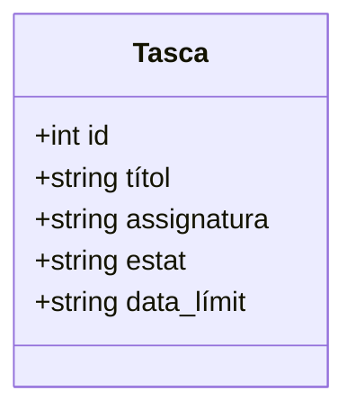

# SPECIFICATIONS.md — Sistema Tasks_app (v3.0)

## 1. Visió General
Tasks_app és una eina CLI lleugera per ajudar als estudiants a gestionar les seves tasques acadèmiques diàries.

La versió 2.0 va afegir la data límit, la modificació i la finalització de tasques i la identificació de tasques urgents i caducades, mantenint la compatibilitat amb les dades generades al sprint 1. La versió 3.0 afegeix el resum estadístic, el filtratge per assignatura i la cerca per paraula clau al títol, sense modificar els formats ni les dades dels sprints anteriors.

## 2. User Stories (Històries d'Usuari)
- US-01: Com a estudiant, vull afegir una tasca amb títol i assignatura per tal de recordar els meus deures.
- US-02: Com a estudiant, vull veure la llista de tasques pendents per tal d'organitzar el meu temps.
- US-03: Com a estudiant, vull assignar una data límit a una tasca per tal de planificar el meu temps d'estudi.
- US-04: Com a estudiant, vull modificar el títol, l'assignatura, la data límit i l'estat d'una tasca per tal de corregir-la sense perdre'n l'identificador.
- US-05: Com a estudiant, vull marcar una tasca com a completada per tal de seguir el progrés dels meus deures.
- US-06: Com a estudiant, vull veure les etiquetes `[CADUCADA]` i `[URGENT]` per tal de prioritzar les tasques que requereixen atenció immediata.
- US-07: Com a estudiant, vull rebre missatges d'error clars per tal de corregir les dades invàlides sense perdre les tasques desades.
- US-08: Com a estudiant, vull disposar d'una data de referència controlada per tal de comprovar les etiquetes de manera reproducible.
- US-09: Com a estudiant, vull veure un resum estadístic de les meves tasques per tal de conèixer ràpidament el meu estat general.
- US-10: Com a estudiant, vull filtrar les tasques per assignatura per tal de treballar només amb una matèria concreta.
- US-11: Com a estudiant, vull cercar tasques per paraula clau al títol per tal de localitzar ràpidament una tasca concreta.
- US-12: Com a estudiant, vull combinar el filtre d'assignatura i la cerca per paraula clau per tal d'obtenir resultats més precisos.
- US-13: Com a estudiant, vull rebre missatges clars quan una consulta no tingui coincidències o quan el resum es combini amb filtres per tal d'entendre el resultat obtingut.

## 3. Model de Dades (Mermaid)


`data_límit` és un camp opcional que s'emmagatzema amb format `YYYY-MM-DD`. Les tasques del sprint 1 que no contenen aquest camp s'interpreten com a tasques sense data límit (RF-08 i RF-09). L'estat pren els valors `pendent` o `completada`.

## 4. Requisits
Els requisits RF-01 a RF-04 del sprint 1 es conserven sense canvis.
- RF-01 : El sistema tasks_app ha de guardar les tasques en un fitxer JSON de persistència local.
- RF-02 : Si el fitxer `data/tasks.json` no existeix, el sistema tasks_app ha de crear `data/tasks.json`  inicialitzat amb una llista JSON buida ([])
- RF-03 : El sistema tasks_app ha de proveir a l'estudiant la capacitat de crear una nova tasca amb estat 'pendent' mitjançant el comandament add --title <títol> --subject <assignatura>.
- RF-04: El sistema tasks_app ha de proveir a l’estudiant la capacitat de visualitzar totes les tasques registrades (incloent-hi el seu ID, títol, assignatura i estat) mitjançant el comandament list.

## 5. Criteris d’acceptació i proves (Gherkin scenarios)
Els escenaris GS-01 a GS-03 del sprint 1 es conserven sense canvis.
- GS-01: Creació correcta d'una tasca
  Atès que la base de dades JSON no conté encara tasques
  quan l’estudiant executa `python src/tasks_app.py add --title 'Pràctica 1' --subject 'RS'
  aleshores el sistema confirma `Tasca [ID: 1] creada amb èxit`
  i la tasca queda registrada al fitxer `data/tasks.json`.

- GS-02: Llistat de tasques quan `data/tasks.json` no conté registres
  Atès que la base de dades JSON no conté encara tasques
  quan l’estudiant executa `python src/tasks_app.py list`
  aleshores el sistema mostra `Registre de tasques buit.`

- GS-03: Llistat de tasques quan data/tasks.json conté registres
  Atès que el fitxer `data/tasks.json` conté les següents tasques:
    | id | títol          | assignatura | estat   |
    | 1  | Pràctica 1     | RS          | pendent |
    | 2  | Examen parcial | SO          | pendent |
  quan l’estudiant executa `python src/tasks_app.py list`
  aleshores el sistema mostra per pantalla:
    "[1] Pràctica 1 (RS) - estat: pendent"
    "[2] Examen parcial (SO) - estat: pendent"

## 6. Increment 2 — Data límit, edició, finalització i priorització

### 6.1 Històries d'usuari
Les històries US-03 a US-08 de la secció 2 segueixen el patró obligatori «Com a estudiant, vull... per tal de...» i cobreixen les cinc funcionalitats noves, la validació d'errors i la reproducibilitat de les proves.

### 6.2 Convenció de redacció SOPHIST
Els requisits RF-05 a RF-25 segueixen rigorosament la plantilla SOPHIST (FunktionsMASTER):

`[condició] + El sistema tasks_app + HA DE + [(donar a l'estudiant la possibilitat de | ser capaç de)] + verb en infinitiu + objecte + [detalls]`

- Veu activa i oració completa.
- Un sol verb principal per requisit.
- El sistema s'anomena explícitament amb `tasks_app`.
- `donar a l'estudiant la possibilitat de` s'usa per a interacció d'usuari; `ser capaç de` per a dependència d'una font externa (dades del sprint 1); la forma directa per a activitat automàtica del sistema.
- Les condicions s'escriuen al començament amb `Quan ...`.

### 6.3 Requisits funcionals nous (RF-05 a RF-25)
- RF-05: El sistema tasks_app HA DE desar el camp opcional `data_límit` en format `YYYY-MM-DD` dins de cada registre de `data/tasks.json`.
- RF-06: El sistema tasks_app HA DE donar a l'estudiant la possibilitat d'assignar una data límit a una tasca nova mitjançant el paràmetre `--due YYYY-MM-DD` del comandament `add`.
- RF-07: El sistema tasks_app HA DE mostrar el missatge `Tasca [ID: <id>] creada amb èxit` després d'afegir una tasca amb data límit, igual que al sprint 1.
- RF-08: El sistema tasks_app HA DE ser capaç de llegir les tasques del sprint 1 emmagatzemades a `data/tasks.json` sense el camp `data_límit`.
- RF-09: El sistema tasks_app HA DE considerar sense data límit les tasques recuperades que no contenen el camp `data_límit`.
- RF-10: Quan l'estudiant introdueix una data límit amb un format diferent de `YYYY-MM-DD` o una data inexistent, el sistema tasks_app HA DE mostrar el missatge `Error: data límit no vàlida. Format esperat: YYYY-MM-DD.`
- RF-11: Quan una operació `add` o `edit` rep una data límit no vàlida, el sistema tasks_app HA DE mantenir `data/tasks.json` sense cap modificació.
- RF-12: El sistema tasks_app HA DE donar a l'estudiant la possibilitat de modificar el títol, l'assignatura, la data límit o l'estat d'una tasca identificada amb `edit --id ID`.
- RF-13: El sistema tasks_app HA DE mantenir l'identificador d'una tasca després d'executar el comandament `edit --id ID`.
- RF-14: El sistema tasks_app HA DE conservar els camps no indicats d'una tasca quan l'estudiant executa `edit --id ID` amb només alguns paràmetres.
- RF-15: El sistema tasks_app HA DE mostrar el missatge `Tasca [ID: <id>] actualitzada amb èxit` després d'una modificació correcta amb `edit --id ID`.
- RF-16: El sistema tasks_app HA DE donar a l'estudiant la possibilitat de marcar com a completada una tasca identificada amb `complete --id ID`.
- RF-17: El sistema tasks_app HA DE mostrar el missatge `Tasca [ID: <id>] completada amb èxit` després d'una finalització correcta amb `complete --id ID`.
- RF-18: Quan l'estudiant indica amb `edit --id ID` o `complete --id ID` un identificador inexistent, el sistema tasks_app HA DE mostrar el missatge `Error: no existeix la tasca amb ID <id>.`
- RF-19: Quan l'estudiant indica amb `edit --id ID` o `complete --id ID` un identificador inexistent, el sistema tasks_app HA DE mantenir `data/tasks.json` sense cap modificació.
- RF-20: Quan una tasca pendent té una data límit anterior a la data de referència, el sistema tasks_app HA DE mostrar l'etiqueta `[CADUCADA]` a la línia corresponent del comandament `list`.
- RF-21: Quan una tasca pendent té una data límit compresa entre la data de referència i els sis dies següents, ambdós inclosos, el sistema tasks_app HA DE mostrar l'etiqueta `[URGENT]` a la línia corresponent del comandament `list`.
- RF-22: Quan una tasca no té data límit, el sistema tasks_app HA DE mostrar la línia corresponent del comandament `list` sense les etiquetes `[URGENT]` ni `[CADUCADA]`.
- RF-23: Quan una tasca té l'estat `completada`, el sistema tasks_app HA DE mostrar la línia corresponent del comandament `list` sense les etiquetes `[URGENT]` ni `[CADUCADA]`.
- RF-24: Quan una tasca pendent té una data límit exactament set dies posterior a la data de referència, el sistema tasks_app HA DE mostrar la línia corresponent del comandament `list` sense l'etiqueta `[URGENT]`.
- RF-25: El sistema tasks_app HA DE fer servir el valor de la variable d'entorn `TASKS_TODAY`, amb format `YYYY-MM-DD`, com a data de referència per a les comprovacions d'urgència i caducitat. Quan `TASKS_TODAY` no està definida, el sistema tasks_app HA DE fer servir la data actual del sistema com a data de referència per a les comprovacions d'urgència i caducitat.

### 6.4 Format de comandaments i sortides
- `add --title <títol> --subject <assignatura> [--due YYYY-MM-DD]`: confirma amb `Tasca [ID: <id>] creada amb èxit` també quan s'indica data límit.
- `edit --id <id> [--title <títol>] [--subject <assignatura>] [--due YYYY-MM-DD] [--status pendent|completada]`: confirma amb `Tasca [ID: <id>] actualitzada amb èxit`. L'ID no es modifica.
- `complete --id <id>`: confirma amb `Tasca [ID: <id>] completada amb èxit` i estableix l'estat `completada`.
- `list` sense data límit: `[<id>] <títol> (<assignatura>) - estat: <estat>`, idèntic al format del sprint 1.
- `list` amb data límit: `[<id>] <títol> (<assignatura>) - estat: <estat> - data límit: <YYYY-MM-DD>`, seguit d'un espai i de l'etiqueta `[CADUCADA]` o `[URGENT]` només si escau.
- Les tasques sense data límit i les tasques completades no porten cap etiqueta, encara que la data límit hagi passat.

### 6.5 Data de referència controlada
Tots els escenaris temporals fixen la data de referència amb `TASKS_TODAY=2026-06-15`, llevat de GS-22, que comprova el comportament per defecte sense definir la variable. Això dona els límits següents:

| Concepte            | Data       | Condició                                  |
| ------------------- | ---------- | ----------------------------------------- |
| Data de referència  | 2026-06-15 | Avui simulada                             |
| Caducada            | 2026-06-14 | Anterior a la data de referència          |
| Urgent (inici)      | 2026-06-15 | Igual a la data de referència             |
| Urgent (final)      | 2026-06-21 | Data de referència + 6 dies               |
| No urgent           | 2026-06-22 | Data de referència + 7 dies               |

Les proves s'executen sobre una còpia aïllada de `data/tasks.json` i no alteren les dades originals de l'aplicació.

Per a GS-22, `TASKS_TODAY` no es defineix i no es modifica el rellotge del sistema: la data límit fixa `1970-01-01` garanteix una classificació estable com a caducada.

### 6.6 Criteris d'acceptació (GS-04 a GS-22)

- GS-04: Creació d'una tasca amb data límit
  Atès que la data de referència controlada és `2026-06-15` (`TASKS_TODAY=2026-06-15`)
  I el fitxer `data/tasks.json` conté `[]`
  Quan l'estudiant executa `python src/tasks_app.py add --title 'Pràctica 1' --subject 'RS' --due 2026-06-20`
  Aleshores el sistema confirma `Tasca [ID: 1] creada amb èxit`
  I el fitxer `data/tasks.json` conté la tasca següent:

    | id | títol      | assignatura | estat   | data_límit |
    | 1  | Pràctica 1 | RS          | pendent | 2026-06-20 |

- GS-05: Compatibilitat amb una tasca del sprint 1 sense data límit
  Atès que el fitxer `data/tasks.json` conté una tasca amb `id` 1, `títol` `Pràctica 1`, `assignatura` `RS`, `estat` `pendent` i sense el camp `data_límit`
  Quan l'estudiant executa `python src/tasks_app.py list`
  Aleshores el sistema mostra `[1] Pràctica 1 (RS) - estat: pendent`
  I la línia no conté les etiquetes `[URGENT]` ni `[CADUCADA]`.

- GS-06: Data límit amb format incorrecte
  Atès que la data de referència controlada és `2026-06-15` (`TASKS_TODAY=2026-06-15`)
  I el fitxer `data/tasks.json` conté `[]`
  Quan l'estudiant executa `python src/tasks_app.py add --title 'Pràctica 1' --subject 'RS' --due 15/06/2026`
  Aleshores el sistema mostra `Error: data límit no vàlida. Format esperat: YYYY-MM-DD.`
  I el fitxer `data/tasks.json` continua contenint `[]`.

- GS-07: Data límit inexistent
  Atès que la data de referència controlada és `2026-06-15` (`TASKS_TODAY=2026-06-15`)
  I el fitxer `data/tasks.json` conté `[]`
  Quan l'estudiant executa `python src/tasks_app.py add --title 'Pràctica 1' --subject 'RS' --due 2026-02-30`
  Aleshores el sistema mostra `Error: data límit no vàlida. Format esperat: YYYY-MM-DD.`
  I el fitxer `data/tasks.json` continua contenint `[]`.

- GS-08: Modificació de tots els camps d'una tasca
  Atès que la data de referència controlada és `2026-06-15` (`TASKS_TODAY=2026-06-15`)
  I el fitxer `data/tasks.json` conté la tasca següent:

    | id | títol      | assignatura | estat   | data_límit |
    | 1  | Pràctica 1 | RS          | pendent | 2026-06-20 |

  Quan l'estudiant executa `python src/tasks_app.py edit --id 1 --title 'Pràctica 2' --subject 'SO' --due 2026-06-21 --status completada`
  Aleshores el sistema mostra `Tasca [ID: 1] actualitzada amb èxit`
  I el fitxer `data/tasks.json` conté la tasca següent:

    | id | títol      | assignatura | estat      | data_límit |
    | 1  | Pràctica 2 | SO          | completada | 2026-06-21 |

- GS-09: Modificació parcial d'una tasca
  Atès que la data de referència controlada és `2026-06-15` (`TASKS_TODAY=2026-06-15`)
  I el fitxer `data/tasks.json` conté la tasca següent:

    | id | títol      | assignatura | estat   | data_límit |
    | 1  | Pràctica 1 | RS          | pendent | 2026-06-20 |

  Quan l'estudiant executa `python src/tasks_app.py edit --id 1 --title 'Pràctica 2'`
  Aleshores el sistema mostra `Tasca [ID: 1] actualitzada amb èxit`
  I el fitxer `data/tasks.json` conté la tasca següent:

    | id | títol      | assignatura | estat   | data_límit |
    | 1  | Pràctica 2 | RS          | pendent | 2026-06-20 |

- GS-10: Identificador inexistent en la modificació
  Atès que el fitxer `data/tasks.json` conté una única tasca amb `id` 1
  Quan l'estudiant executa `python src/tasks_app.py edit --id 99 --title 'Inexistent'`
  Aleshores el sistema mostra `Error: no existeix la tasca amb ID 99.`
  I el fitxer `data/tasks.json` roman amb la mateixa única tasca amb `id` 1.

- GS-11: Finalització d'una tasca
  Atès que la data de referència controlada és `2026-06-15` (`TASKS_TODAY=2026-06-15`)
  I el fitxer `data/tasks.json` conté la tasca següent:

    | id | títol      | assignatura | estat   | data_límit |
    | 1  | Pràctica 1 | RS          | pendent | 2026-06-20 |

  Quan l'estudiant executa `python src/tasks_app.py complete --id 1`
  Aleshores el sistema mostra `Tasca [ID: 1] completada amb èxit`
  I el fitxer `data/tasks.json` conté la tasca següent:

    | id | títol      | assignatura | estat      | data_límit |
    | 1  | Pràctica 1 | RS          | completada | 2026-06-20 |

- GS-12: Identificador inexistent en la finalització
  Atès que el fitxer `data/tasks.json` conté una única tasca amb `id` 1
  Quan l'estudiant executa `python src/tasks_app.py complete --id 99`
  Aleshores el sistema mostra `Error: no existeix la tasca amb ID 99.`
  I el fitxer `data/tasks.json` roman amb la mateixa única tasca amb `id` 1.

- GS-13: Tasca pendent caducada
  Atès que la data de referència controlada és `2026-06-15` (`TASKS_TODAY=2026-06-15`)
  I el fitxer `data/tasks.json` conté la tasca següent:

    | id | títol      | assignatura | estat   | data_límit |
    | 1  | Pràctica 1 | RS          | pendent | 2026-06-14 |

  Quan l'estudiant executa `python src/tasks_app.py list`
  Aleshores el sistema mostra `[1] Pràctica 1 (RS) - estat: pendent - data límit: 2026-06-14 [CADUCADA]`.

- GS-14: Tasca pendent urgent amb la data límit avui
  Atès que la data de referència controlada és `2026-06-15` (`TASKS_TODAY=2026-06-15`)
  I el fitxer `data/tasks.json` conté la tasca següent:

    | id | títol      | assignatura | estat   | data_límit |
    | 1  | Pràctica 1 | RS          | pendent | 2026-06-15 |

  Quan l'estudiant executa `python src/tasks_app.py list`
  Aleshores el sistema mostra `[1] Pràctica 1 (RS) - estat: pendent - data límit: 2026-06-15 [URGENT]`.

- GS-15: Tasca pendent urgent amb la data límit a sis dies
  Atès que la data de referència controlada és `2026-06-15` (`TASKS_TODAY=2026-06-15`)
  I el fitxer `data/tasks.json` conté la tasca següent:

    | id | títol      | assignatura | estat   | data_límit |
    | 1  | Pràctica 1 | RS          | pendent | 2026-06-21 |

  Quan l'estudiant executa `python src/tasks_app.py list`
  Aleshores el sistema mostra `[1] Pràctica 1 (RS) - estat: pendent - data límit: 2026-06-21 [URGENT]`.

- GS-16: Tasca pendent amb la data límit a set dies
  Atès que la data de referència controlada és `2026-06-15` (`TASKS_TODAY=2026-06-15`)
  I el fitxer `data/tasks.json` conté la tasca següent:

    | id | títol      | assignatura | estat   | data_límit |
    | 1  | Pràctica 1 | RS          | pendent | 2026-06-22 |

  Quan l'estudiant executa `python src/tasks_app.py list`
  Aleshores el sistema mostra `[1] Pràctica 1 (RS) - estat: pendent - data límit: 2026-06-22`
  I la línia no conté l'etiqueta `[URGENT]`.

- GS-17: Tasca pendent sense data límit
  Atès que la data de referència controlada és `2026-06-15` (`TASKS_TODAY=2026-06-15`)
  I el fitxer `data/tasks.json` conté la tasca següent:

    | id | títol      | assignatura | estat   | data_límit |
    | 1  | Pràctica 1 | RS          | pendent |            |

  Quan l'estudiant executa `python src/tasks_app.py list`
  Aleshores el sistema mostra `[1] Pràctica 1 (RS) - estat: pendent`
  I la línia no conté les etiquetes `[URGENT]` ni `[CADUCADA]`.

- GS-18: Tasca completada amb la data límit caducada
  Atès que la data de referència controlada és `2026-06-15` (`TASKS_TODAY=2026-06-15`)
  I el fitxer `data/tasks.json` conté la tasca següent:

    | id | títol      | assignatura | estat      | data_límit |
    | 1  | Pràctica 1 | RS          | completada | 2026-06-10 |

  Quan l'estudiant executa `python src/tasks_app.py list`
  Aleshores el sistema mostra `[1] Pràctica 1 (RS) - estat: completada - data límit: 2026-06-10`
  I la línia no conté les etiquetes `[URGENT]` ni `[CADUCADA]`.

- GS-19: Data de referència controlada davant d'una data real diferent
  Atès que la data real del sistema és `2026-06-01`
  I la variable d'entorn `TASKS_TODAY` és `2026-06-15`
  I el fitxer `data/tasks.json` conté la tasca següent:

    | id | títol      | assignatura | estat   | data_límit |
    | 1  | Pràctica 1 | RS          | pendent | 2026-06-20 |

  Quan l'estudiant executa `python src/tasks_app.py list`
  Aleshores el sistema mostra `[1] Pràctica 1 (RS) - estat: pendent - data límit: 2026-06-20 [URGENT]`
  I el resultat no depèn de la data real del sistema.

- GS-20: Modificació amb una data límit invàlida
  Atès que la data de referència controlada és `2026-06-15` (`TASKS_TODAY=2026-06-15`)
  I el fitxer `data/tasks.json` conté la tasca següent:

    | id | títol      | assignatura | estat   | data_límit |
    | 1  | Pràctica 1 | RS          | pendent | 2026-06-20 |

  Quan l'estudiant executa `python src/tasks_app.py edit --id 1 --due 2026-02-30`
  Aleshores el sistema mostra `Error: data límit no vàlida. Format esperat: YYYY-MM-DD.`
  I el fitxer `data/tasks.json` roman amb la mateixa tasca amb `id` 1, `títol` `Pràctica 1`, `assignatura` `RS`, `estat` `pendent` i `data_límit` `2026-06-20`.

- GS-21: Tasca pendent amb la data límit superior a set dies
  Atès que la data de referència controlada és `2026-06-15` (`TASKS_TODAY=2026-06-15`)
  I el fitxer `data/tasks.json` conté la tasca següent:

    | id | títol      | assignatura | estat   | data_límit |
    | 1  | Pràctica 1 | RS          | pendent | 2026-06-23 |

  Quan l'estudiant executa `python src/tasks_app.py list`
  Aleshores el sistema mostra `[1] Pràctica 1 (RS) - estat: pendent - data límit: 2026-06-23`
  I la línia no conté les etiquetes `[URGENT]` ni `[CADUCADA]`.

- GS-22: Data de referència sense `TASKS_TODAY`
  Atès que la variable d'entorn `TASKS_TODAY` no està definida
  I no es modifica el rellotge del sistema
  I el fitxer `data/tasks.json` conté la tasca següent:

    | id | títol      | assignatura | estat   | data_límit |
    | 1  | Pràctica 1 | RS          | pendent | 1970-01-01 |

  Quan l'estudiant executa `python src/tasks_app.py list`
  Aleshores el sistema mostra `[1] Pràctica 1 (RS) - estat: pendent - data límit: 1970-01-01 [CADUCADA]`
  I el resultat prové de la data actual del sistema sense alterar el rellotge.

## 7. Increment 3 — Resum, filtratge i cerca de tasques

### 7.1 Històries d'usuari

Les històries US-09 a US-13 de la secció 2 cobreixen el resum estadístic, el filtratge per assignatura, la cerca per paraula clau al títol, la combinació de filtres i els missatges clars davant de consultes sense resultat o combinacions invàlides.

### 7.2 Requisits funcionals nous (RF-26 a RF-43)

Els requisits RF-01 a RF-25 dels sprints anteriors es conserven sense canvis. Els requisits RF-26 a RF-43 segueixen rigorosament la plantilla SOPHIST (FunktionsMASTER) descrita a la secció 6.2.

- RF-26: El sistema tasks_app HA DE donar a l'estudiant la possibilitat de mostrar un resum estadístic mitjançant `list --summary`.
- RF-27: El sistema tasks_app HA DE mostrar al resum el nombre total de tasques registrades.
- RF-28: El sistema tasks_app HA DE mostrar al resum el nombre de tasques amb estat `pendent`.
- RF-29: El sistema tasks_app HA DE mostrar al resum el nombre de tasques amb estat `completada`.
- RF-30: El sistema tasks_app HA DE mostrar al resum el nombre de tasques pendents caducades, d'acord amb els criteris temporals del sprint 2.
- RF-31: El sistema tasks_app HA DE mostrar al resum el nombre de tasques pendents urgents, d'acord amb els criteris temporals del sprint 2.
- RF-32: El sistema tasks_app HA DE excloure del recompte de tasques caducades i urgents les tasques amb estat `completada`.
- RF-33: El sistema tasks_app HA DE donar a l'estudiant la possibilitat de filtrar les tasques per assignatura mitjançant `list --subject ASSIGNATURA`.
- RF-34: Quan s'indica `list --subject ASSIGNATURA`, el sistema tasks_app HA DE comparar el valor amb l'assignatura de cada tasca sense tenir en compte majúscules i minúscules i només amb coincidència exacta.
- RF-35: El sistema tasks_app HA DE donar a l'estudiant la possibilitat de cercar tasques per paraula clau al títol mitjançant `list --keyword PARAULA`.
- RF-36: Quan s'indica `list --keyword PARAULA`, el sistema tasks_app HA DE comparar el valor amb el títol de cada tasca sense tenir en compte majúscules i minúscules i admetent coincidències parcials.
- RF-37: Quan s'indiquen alhora `--subject ASSIGNATURA` i `--keyword PARAULA`, el sistema tasks_app HA DE mostrar només les tasques que compleixen ambdues condicions.
- RF-38: Quan `list --summary` es combina amb `--subject ASSIGNATURA` o `--keyword PARAULA`, el sistema tasks_app HA DE mostrar el missatge `Error: --summary no es pot combinar amb --subject ni --keyword.` sense mostrar cap resum ni llistat.
- RF-39: Quan una consulta amb filtres no troba cap tasca, el sistema tasks_app HA DE mostrar el missatge `No s'han trobat tasques que compleixin els filtres.`
- RF-40: El sistema tasks_app HA DE mostrar les tasques filtrades amb el mateix format de línia i les mateixes etiquetes `[CADUCADA]` i `[URGENT]` que el comandament `list` del sprint 2.
- RF-41: El sistema tasks_app HA DE mostrar el resum amb el format exacte definit a la secció 7.3, inclòs el cas de registre buit amb tots els recomptes a zero.
- RF-42: Quan `data/tasks.json` ja existeix, el sistema tasks_app HA DE mantenir el fitxer sense cap modificació després d'executar una consulta vàlida amb `list --summary`, `list --subject`, `list --keyword` o una combinació d'aquestes opcions.
- RF-43: El sistema tasks_app HA DE conservar el missatge `Registre de tasques buit.` per a `list` sense opcions quan el fitxer no conté cap tasca.

### 7.3 Formats exactes de sortida

`list --summary` mostra exactament cinc línies de recompte precedides d'una capçalera:

```
Resum de tasques:
- Total: <n>
- Pendents: <n>
- Completades: <n>
- Caducades: <n>
- Urgents: <n>
```

- `<n>` és un enter sense zeros a l'esquerra.
- `Caducades` i `Urgents` compten només tasques pendents: una tasca completada amb data límit passada no incrementa aquests recomptes.
- Si el registre és buit, els cinc recomptes són `0` i el resum es mostra igualment.

`list --subject ASSIGNATURA`, `list --keyword PARAULA` i la combinació d'ambdues opcions mostren les línies de resultat amb el format de la secció 6.4, sense cap capçalera addicional:

```
[<id>] <títol> (<assignatura>) - estat: <estat>
[<id>] <títol> (<assignatura>) - estat: <estat> - data límit: <YYYY-MM-DD> [CADUCADA]
[<id>] <títol> (<assignatura>) - estat: <estat> - data límit: <YYYY-MM-DD> [URGENT]
```

Quan una consulta amb `--subject`, `--keyword` o ambdós filtres no troba cap tasca, inclòs el cas de registre buit, es mostra exactament:

```
No s'han trobat tasques que compleixin els filtres.
```

Si `data/tasks.json` no existeix, s'aplica RF-02: la consulta vàlida crea el fitxer amb `[]` abans de mostrar la sortida. Així, `list --summary` mostra tots els recomptes a zero i les consultes amb filtres mostren el missatge de sense coincidències.

Quan `--summary` es combina amb qualsevol filtre, es mostra exactament aquesta línia i cap altra:

```
Error: --summary no es pot combinar amb --subject ni --keyword.
```

`list` sense opcions i amb el registre buit conserva el missatge del sprint 1:

```
Registre de tasques buit.
```

### 7.4 Criteris d'acceptació (GS-23 a GS-43)

Els escenaris GS-01 a GS-22 dels sprints anteriors es conserven sense canvis.

- GS-23: Resum estadístic amb tasques pendents i completades
  Atès que la data de referència controlada és `2026-06-15` (`TASKS_TODAY=2026-06-15`)
  I el fitxer `data/tasks.json` conté les tasques següents:

    | id | títol      | assignatura | estat      | data_límit |
    | 1  | Pràctica 1 | RS          | pendent    | 2026-06-14 |
    | 2  | Pràctica 2 | RS          | pendent    | 2026-06-16 |
    | 3  | Apunts     | SO          | pendent    |            |
    | 4  | Examen     | RS          | completada | 2026-06-10 |

  Quan l'estudiant executa `python src/tasks_app.py list --summary`
  Aleshores el sistema mostra:
    "Resum de tasques:"
    "- Total: 4"
    "- Pendents: 3"
    "- Completades: 1"
    "- Caducades: 1"
    "- Urgents: 1"

- GS-24: Resum amb el registre buit
  Atès que el fitxer `data/tasks.json` conté `[]`
  Quan l'estudiant executa `python src/tasks_app.py list --summary`
  Aleshores el sistema mostra:
    "Resum de tasques:"
    "- Total: 0"
    "- Pendents: 0"
    "- Completades: 0"
    "- Caducades: 0"
    "- Urgents: 0"

- GS-25: Límits temporals al resum
  Atès que la data de referència controlada és `2026-06-15` (`TASKS_TODAY=2026-06-15`)
  I el fitxer `data/tasks.json` conté les tasques següents:

    | id | títol      | assignatura | estat      | data_límit |
    | 1  | Avui       | RS          | pendent    | 2026-06-15 |
    | 2  | Sis dies   | RS          | pendent    | 2026-06-21 |
    | 3  | Set dies   | SO          | pendent    | 2026-06-22 |
    | 4  | Feta       | SO          | completada | 2026-06-16 |

  Quan l'estudiant executa `python src/tasks_app.py list --summary`
  Aleshores el sistema mostra:
    "Resum de tasques:"
    "- Total: 4"
    "- Pendents: 3"
    "- Completades: 1"
    "- Caducades: 0"
    "- Urgents: 2"

- GS-26: Resum sense modificar les dades
  Atès que la data de referència controlada és `2026-06-15` (`TASKS_TODAY=2026-06-15`)
  I el fitxer `data/tasks.json` conté una tasca amb `id` 1, `títol` `Pràctica 1`, `assignatura` `RS`, `estat` `pendent` i `data_límit` `2026-06-16`
  Quan l'estudiant executa `python src/tasks_app.py list --summary`
  Aleshores el sistema mostra:
    "Resum de tasques:"
    "- Total: 1"
    "- Pendents: 1"
    "- Completades: 0"
    "- Caducades: 0"
    "- Urgents: 1"
  I el fitxer `data/tasks.json` roman byte a byte sense cap modificació.

- GS-27: Filtratge per assignatura exacte i insensible a majúscules
  Atès que la data de referència controlada és `2026-06-15` (`TASKS_TODAY=2026-06-15`)
  I el fitxer `data/tasks.json` conté les tasques següents:

    | id | títol      | assignatura | estat   | data_límit |
    | 1  | Pràctica 1 | RS          | pendent | 2026-06-14 |
    | 2  | Pràctica 2 | rs          | pendent | 2026-06-20 |
    | 3  | Examen     | SO          | pendent |            |
    | 4  | Pràctica 4 | RST         | pendent |            |

  Quan l'estudiant executa `python src/tasks_app.py list --subject rs`
  Aleshores el sistema mostra:
    "[1] Pràctica 1 (RS) - estat: pendent - data límit: 2026-06-14 [CADUCADA]"
    "[2] Pràctica 2 (rs) - estat: pendent - data límit: 2026-06-20 [URGENT]"
  I no mostra les tasques amb assignatura `SO` ni `RST`.

- GS-28: Filtratge per assignatura sense coincidències
  Atès que el fitxer `data/tasks.json` conté una tasca amb `assignatura` `SO`
  Quan l'estudiant executa `python src/tasks_app.py list --subject RS`
  Aleshores el sistema mostra `No s'han trobat tasques que compleixin els filtres.`

- GS-29: Filtratge per assignatura amb el registre buit
  Atès que el fitxer `data/tasks.json` conté `[]`
  Quan l'estudiant executa `python src/tasks_app.py list --subject RS`
  Aleshores el sistema mostra `No s'han trobat tasques que compleixin els filtres.`

- GS-30: Cerca per paraula clau parcial i insensible a majúscules
  Atès que la data de referència controlada és `2026-06-15` (`TASKS_TODAY=2026-06-15`)
  I el fitxer `data/tasks.json` conté les tasques següents:

    | id | títol                | assignatura | estat   | data_límit |
    | 1  | Pràctica de Xarxes   | RS          | pendent | 2026-06-16 |
    | 2  | Xarxa avançada       | SO          | pendent | 2026-06-30 |
    | 3  | Examen               | RS          | pendent |            |

  Quan l'estudiant executa `python src/tasks_app.py list --keyword xar`
  Aleshores el sistema mostra:
    "[1] Pràctica de Xarxes (RS) - estat: pendent - data límit: 2026-06-16 [URGENT]"
    "[2] Xarxa avançada (SO) - estat: pendent - data límit: 2026-06-30"

- GS-31: Cerca per paraula clau sense coincidències
  Atès que el fitxer `data/tasks.json` conté tasques amb títols que no contenen `examen`
  Quan l'estudiant executa `python src/tasks_app.py list --keyword examen`
  Aleshores el sistema mostra `No s'han trobat tasques que compleixin els filtres.`

- GS-32: Cerca per paraula clau amb el registre buit
  Atès que el fitxer `data/tasks.json` conté `[]`
  Quan l'estudiant executa `python src/tasks_app.py list --keyword pràctica`
  Aleshores el sistema mostra `No s'han trobat tasques que compleixin els filtres.`

- GS-33: Combinació de filtres amb coincidències
  Atès que la data de referència controlada és `2026-06-15` (`TASKS_TODAY=2026-06-15`)
  I el fitxer `data/tasks.json` conté les tasques següents:

    | id | títol      | assignatura | estat   | data_límit |
    | 1  | Pràctica 1 | RS          | pendent | 2026-06-14 |
    | 2  | Pràctica 2 | RS          | pendent | 2026-06-20 |
    | 3  | Pràctica 3 | SO          | pendent |            |
    | 4  | Examen     | RS          | pendent |            |

  Quan l'estudiant executa `python src/tasks_app.py list --subject rs --keyword pràctica`
  Aleshores el sistema mostra:
    "[1] Pràctica 1 (RS) - estat: pendent - data límit: 2026-06-14 [CADUCADA]"
    "[2] Pràctica 2 (RS) - estat: pendent - data límit: 2026-06-20 [URGENT]"
  I no mostra les tasques 3 i 4.

- GS-34: Combinació de filtres sense coincidències
  Atès que el fitxer `data/tasks.json` conté les tasques següents:

    | id | títol      | assignatura | estat   | data_límit |
    | 1  | Pràctica 1 | RS          | pendent |            |
    | 2  | Examen     | SO          | pendent |            |

  Quan l'estudiant executa `python src/tasks_app.py list --subject so --keyword pràctica`
  Aleshores el sistema mostra `No s'han trobat tasques que compleixin els filtres.`

- GS-35: Resum combinat amb filtre per assignatura
  Atès que el fitxer `data/tasks.json` conté una tasca amb `assignatura` `RS`
  Quan l'estudiant executa `python src/tasks_app.py list --summary --subject RS`
  Aleshores el sistema mostra `Error: --summary no es pot combinar amb --subject ni --keyword.`
  I no mostra cap resum ni cap línia de llistat.

- GS-36: Resum combinat amb cerca per paraula clau
  Atès que el fitxer `data/tasks.json` conté una tasca amb `títol` `Pràctica 1`
  Quan l'estudiant executa `python src/tasks_app.py list --summary --keyword pràctica`
  Aleshores el sistema mostra `Error: --summary no es pot combinar amb --subject ni --keyword.`
  I no mostra cap resum ni cap línia de llistat.

- GS-37: Resum combinat amb ambdós filtres
  Atès que el fitxer `data/tasks.json` conté una tasca amb `assignatura` `RS` i `títol` `Pràctica 1`
  Quan l'estudiant executa `python src/tasks_app.py list --summary --subject RS --keyword pràctica`
  Aleshores el sistema mostra `Error: --summary no es pot combinar amb --subject ni --keyword.`
  I no mostra cap resum ni cap línia de llistat.

- GS-38: Conservació del format i les etiquetes en resultats filtrats
  Atès que la data de referència controlada és `2026-06-15` (`TASKS_TODAY=2026-06-15`)
  I el fitxer `data/tasks.json` conté les tasques següents:

    | id | títol      | assignatura | estat      | data_límit |
    | 1  | Caducada   | RS          | pendent    | 2026-06-14 |
    | 2  | Feta       | RS          | completada | 2026-06-10 |
    | 3  | Sense data | RS          | pendent    |            |

  Quan l'estudiant executa `python src/tasks_app.py list --subject rs`
  Aleshores el sistema mostra:
    "[1] Caducada (RS) - estat: pendent - data límit: 2026-06-14 [CADUCADA]"
    "[2] Feta (RS) - estat: completada - data límit: 2026-06-10"
    "[3] Sense data (RS) - estat: pendent"
  I cap línia inclou una capçalera addicional.

- GS-39: Consultes amb filtres sense modificar les dades
  Atès que el fitxer `data/tasks.json` conté una tasca amb `assignatura` `RS` i `títol` `Pràctica 1`
  Quan l'estudiant executa `python src/tasks_app.py list --subject rs --keyword pràctica`
  Aleshores el sistema mostra la tasca coincident amb el format del sprint 2
  I el fitxer `data/tasks.json` roman byte a byte sense cap modificació.

- GS-40: Inicialització del fitxer amb `list --summary`
  Atès que el fitxer `data/tasks.json` no existeix
  Quan l'estudiant executa `python src/tasks_app.py list --summary`
  Aleshores el sistema mostra:
    "Resum de tasques:"
    "- Total: 0"
    "- Pendents: 0"
    "- Completades: 0"
    "- Caducades: 0"
    "- Urgents: 0"
  I el fitxer `data/tasks.json` s'ha creat amb el contingut `[]`, segons RF-02.

- GS-41: Inicialització del fitxer amb filtre per assignatura
  Atès que el fitxer `data/tasks.json` no existeix
  Quan l'estudiant executa `python src/tasks_app.py list --subject RS`
  Aleshores el sistema mostra `No s'han trobat tasques que compleixin els filtres.`
  I el fitxer `data/tasks.json` s'ha creat amb el contingut `[]`, segons RF-02.

- GS-42: Inicialització del fitxer amb cerca per paraula clau
  Atès que el fitxer `data/tasks.json` no existeix
  Quan l'estudiant executa `python src/tasks_app.py list --keyword pràctica`
  Aleshores el sistema mostra `No s'han trobat tasques que compleixin els filtres.`
  I el fitxer `data/tasks.json` s'ha creat amb el contingut `[]`, segons RF-02.

- GS-43: Inicialització del fitxer amb filtres combinats
  Atès que el fitxer `data/tasks.json` no existeix
  Quan l'estudiant executa `python src/tasks_app.py list --subject RS --keyword pràctica`
  Aleshores el sistema mostra `No s'han trobat tasques que compleixin els filtres.`
  I el fitxer `data/tasks.json` s'ha creat amb el contingut `[]`, segons RF-02.

### 7.5 Data de referència, aïllament i no modificació

Tots els escenaris GS-23 a GS-43 fixen la data de referència amb `TASKS_TODAY=2026-06-15` quan la sortida depèn de dates, reutilitzant els límits de la secció 6.5: caducada el 2026-06-14, urgent del 2026-06-15 al 2026-06-21, i sense etiqueta a partir del 2026-06-22. Cap escenari modifica el rellotge del sistema.

Les proves s'executen sobre una còpia aïllada de `data/tasks.json`, d'acord amb les directives de dates d'`AGENTS.md`. Quan el fitxer ja existeix, les consultes vàlides (`--summary`, `--subject`, `--keyword` i la combinació d'ambdós filtres) són de només lectura: no el reescriuen ni el reordenen. Quan el fitxer no existeix, s'aplica RF-02 i la consulta vàlida el crea amb `[]`; en canvi, les combinacions invàlides de `--summary` amb filtres no són consultes vàlides i no creen el fitxer.
